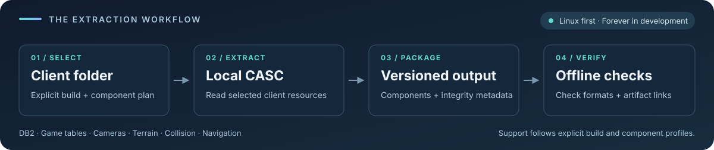

<h1 align="center">RustyCore Extractors</h1>

<p align="center">
  <strong>Local client data → versioned server resources</strong><br>
  Standalone C++ tools and a growing Rust extraction pipeline for RustyCore.
</p>

<p align="center">
  <a href="LICENSE"></a>
  <a href="https://github.com/alseif0x/rustycore-extractors/tree/forever"></a>
  
  
</p>

<p align="center">
  <a href="#current-status">Status</a> ·
  <a href="#find-your-starting-point">Start here</a> ·
  <a href="#build-the-rust-product">Rust quick start</a> ·
  <a href="#build-the-existing-suite">C++ suite</a> ·
  <a href="#documentation">Documentation</a> ·
  <a href="#contributing">Contributing</a>
</p>

> [!IMPORTANT]
> **Forever is in development.** Bounded Linux extraction and reader checks
> exist, but complete client extraction, full world resources and RustyCore
> runtime acceptance remain open. Windows delivery is deferred.



Choose a supported plan, point the tool at your client folder, and keep output
in a separate directory. The [status tables](#current-status) below describe
which builds and components have been exercised so far.

## What this repository is

Standalone, versioned extraction tools for
[RustyCore](https://github.com/alseif0x/rustycore). They turn locally installed
client data into tables, cameras, terrain, collision and navigation resources,
with explicit input contracts and separate output verification.

There are two distinct version lines:

| Version line | Purpose | Compatibility boundary |
| --- | --- | --- |
| [`3.4.3`](https://github.com/alseif0x/rustycore-extractors/tree/3.4.3) | Preserved WotLK Classic C++ suite | `wow_classic` 3.4.3, build 51943 |
| [`forever`](https://github.com/alseif0x/rustycore-extractors/tree/forever) | Default branch; Rust development for WoW Forever 1.60.1 Beta x64 | Explicit build and component profiles; full extraction remains unfinished |

The standalone C++ targets retain their **3.4.3/51943** contract when built
from `forever`. Selecting a branch does not change their supported client or
output formats. The Rust product is the separate `forever-extractor` binary.

## Find your starting point

| I want to… | Start here |
| --- | --- |
| See what works and what is still missing | [Current status](#current-status) and [completion checklist](docs/forever-completion.md) |
| Build the Rust command-line tool | [Rust quick start](#build-the-rust-product) |
| Prepare an extraction plan or verify a package | [Product guide](docs/forever-product.md) |
| Review the available-map Linux terrain results | [Terrain v13 guide](docs/forever-terrain-v13.md#subsequent-real-all-available-terrain-acceptance) |
| Review build-70450 available-map terrain results | [Product v20 scope](docs/forever-product-v20.md) and [real v20 checkpoint](docs/forever-progress-log.md#2026-10-19-build-70450-full-maps-terrain-v20) |
| Review the synthetic build-70450 map-domain navigation profile | [Product v21 scope](docs/forever-product-v21.md) |
| Review the build-70450 selected-map geometry profile and bounded real query evidence | [Product v22 scope](docs/forever-product-v22.md) |
| Review the build-70450 selected-filesystem navigation API and related evidence | [Navigation scope and evidence](docs/forever-navigation.md#2026-10-19-rooted-filesystem-api-for-available-selected-navigation) |
| Use the build-70450 selected-navigation Linux CLI | [Product v23 guide](docs/forever-product-v23.md) and [real ground-navigation checkpoint](docs/forever-navigation.md#2026-10-20-bounded-real-v23-navigation-with-nonempty-terrain) |
| Review build-70450 v24 | [Product v24 scope](docs/forever-product-v24.md): synthetic/software only; the real esES Map attempt fails at DB2 encoding verification |
| Review build-70450 v25 | [Product v25 scope](docs/forever-product-v25.md): authenticated Map with declared TACT-section skipping; synthetic/software gates only |
| Use the preserved 3.4.3 extractors | [C++ build](#build-the-existing-suite) and [standalone guide](docs/standalone-cpp-suite.md) |
| Help develop the Forever pipeline | [Contributing](#contributing) and [operating guide](AGENTS.md) |

## Current status

**Linux comes first:** complete acquisition, component output, full world
operation, runtime integration and reproducible distribution are the delivery
goals. The [completion checklist](docs/forever-completion.md) is the detailed
source of truth; the table below summarizes the boundaries.

| Component | Implemented and evidenced scope | Still required for complete Forever delivery |
| --- | --- | --- |
| Local acquisition | Bounded Rust CASC reads, metadata authentication and explicit available-section APIs | Complete required client resources for each admitted collection |
| DB2 | Build-specific catalogs, decoding, batch extraction and verification; a real v16 esES package extracted and verified 1,055 keylessly readable declarations out of 1,161 | Complete catalog acquisition and required server consumers; the other 106 esES declarations are encrypted without an available key |
| Game tables & cameras | A real v19 package extracted and verified 20 GameTables, ten raw camera files and its selected `CinematicCamera` DB2; the runtime GameTable loader accepted the 20 tables | Full target coverage; cameras remain opaque raw files and playback is outside extraction |
| Terrain / MAPS | ADT conversion, assembly and readers; real 70374/v13 and 70450/v20 available-map packages are verified. V20 contains 3,322 MAPS tiles and 71 tilelists; a bounded runtime check against reproducible package `ad7f115d…` (commit `35a4a14`) parsed 1,724 tiles / 43,100 points: 988 tiles / 24,700 points for map 1 and 736 tiles / 18,400 points for map 0 | Whole-client map coverage and full world/runtime acceptance; the 70450 ADT/MAPS wire-format assumption is unproven |
| Collision / VMaps | Linux v22 has bounded real selected-map extraction and verification. The latest esES geometry input contains 149 artifacts / 2,199,694 bytes and feeds the [ground-navigation checkpoint](docs/forever-navigation.md#2026-10-20-bounded-real-v23-navigation-with-nonempty-terrain). Placement-only models, available Map coverage and excluded GameObject globals remain explicit. | Complete geometry, C++/TrinityCore parity, RustyCore runtime and full-world/whole-client coverage remain open |
| Navigation / MMaps | Linux v23 generated and verified navigation with six real terrain tiles: eight nonempty MMap tiles, three empty outcomes, a 40-byte global and coverage (ten artifacts / 3,787,736 bytes). [Ground checkpoint](docs/forever-navigation.md#2026-10-20-bounded-real-v23-navigation-with-nonempty-terrain). The optional RustyCore library worker, merged in PR #1454, admits the original eight containers, resolves 98 proximity queries and preserves all 256 raw SDK route outcomes: six complete and 250 partial. It unloads all tiles and instance queries; the packaged executable reproduces the payloads. The earlier empty-terrain package separately passed ten CLI lifecycle cases. | Complete-source/geometry, movement/path execution, off-mesh/full-world, Trinity parity, runtime/server, Windows and release acceptance remain open |
| Packaging | Local Linux v13 candidate: two identical fresh archives/binaries, a matching moved-source offline rebuild, 47 synthetic CLI/fixture cases and nine real navigation payloads identical to the baseline ([qualification](docs/forever-distribution.md)) | Complete extractor release and distribution |
| Windows | Platform work and historical scoped evidence are retained | Development and delivery resume after the Linux milestone |

The [selected-navigation consumer](docs/forever-rustycore-navigation-consumer.md)
is merged into RustyCore's `forever` branch via
[PR #1454](https://github.com/alseif0x/rustycore/pull/1454), at squash commit
`984a0c6`. Its shared package API and native manager/worker pass bounded local
acceptance. Exact source and merge identities are recorded in the consumer
guide and [#104](https://github.com/alseif0x/rustycore-extractors/issues/104).
The v13 source has matching fresh archives and a moved-source offline rebuild;
the packaged binary also passes synthetic and real navigation checks. The core
integration's historical qualification records 5,944 scoped tests passing and
three ignored; the inherited general validation rejection remains. The merge
does not change complete-geometry or server/world acceptance. Historical v12
evidence keeps its frozen scope.

Separate README-only [RustyCore PR #1456](https://github.com/alseif0x/rustycore/pull/1456)
was merged at `338203385`. Follow its
[extraction-tools guide](https://github.com/alseif0x/rustycore/blob/forever/README.md#forever-extraction-tools)
for manual pinned sibling-source preparation before Cargo, compilation and
package verification. CI workflow bootstrapping remains a separate unpublished
follow-up pending the required GitHub OAuth workflow scope.

### Implemented build-70450 product revisions

| Revision | Component mask | Profile boundary |
| --- | ---: | --- |
| v15 | 16 | Compatible GNU15-v2 collision-only, disabled keys |
| v16 / v17 | 1 | DB2-only, respectively disabled / supplied keys |
| v18 | 16 | Compatible GNU15-v2 collision-only, supplied keys |
| v19 | 7 | DB2 + GameTables + cameras |
| v20 | 8 | Compatible available-map terrain-only |
| v21 | 57 | One-map DB2 + terrain + collision + navigation |
| v22 | 16 | Selected-map geometry with profile exclusions |
| v23 | 32 | Selected navigation from sealed v20/v22 packages |
| v24 | 9 | Authenticated sealed Map + available-map terrain |
| v25 | 9 | Authenticated Map with explicitly declared partial encrypted-section skips + available-map terrain |

### Current build-specific scope

| Build | What the evidence establishes | Boundary |
| --- | --- | --- |
| **70374** | Linux v10 selects DB2; v11 adds game tables and raw cameras. Terrain v12/v13 has separate real extraction evidence, including the available-map run linked below. Bounded lifecycle and local packaging checks exist. | Full catalog, whole-client coverage, complete collision/navigation and runtime support remain open. |
| **70425** | Explicit disabled-key bootstrap, a separate catalog, available-section readers and complete liquid reader APIs. Compatible world traversal joins Map/liquids, WDTs, object ADTs and parent replay, with synthetic library checks. A bounded real Map/GameObject probe is recorded. | Final compatible VMaps, complete real world resources, a 70425 product profile and runtime acceptance remain open. |
| **70450** | Linux product revisions v15–v24 are separately gated: masks v15=16, v16/v17=1, v18=16, v19=7, v20=8, v21=57, v22=16, v23=32, v24=9. Real v16 DB2 (1,055 esES declarations), v19 GameTables/cameras and v20 available-map terrain packages were extracted and verified. V21 has a real failure diagnostic, not a package. V22 has bounded real esES map-48 acceptance with the post-audit binary `d75acb087b49bdd759c25ff64904085f7909f7e5b2536ddcfc593123b66cce89`: verified package, 66 files / 2,079,754 bytes, inventory `aa9d5cee…`; 65 of 66 published artifacts are byte-identical to the preceding binary; only the coverage record and the context-bearing package manifest/seal differ. Its selected-map/ancestor geometry uses available Map, excludes GameObject globals by profile and omits LiquidObject, MMaps and full-world output. Separate bounded native probes used the typed v16 payload adapter: the first accepted one tile, and a later probe loaded/unloaded four tiles and found complete paths across the loaded set. These probes do not change any product revision's scope. The Linux available-selected filesystem library owner has separate bounded real acceptance: one map, four nonempty tiles and one global, with all five artifact hashes matching the preceding manual outputs; v23 subsequently adds a separately validated selected-navigation CLI using sealed v20/v22 packages. Its bounded real run passed ten lifecycle cases and produced six artifacts, with the five navigation payloads matching these filesystem-owner outputs. V24 combines one sealed Map DB2 artifact with v20 terrain and independently re-derives Map identity/order/counts during offline verification. Its synthetic/software checks are the only qualification: a real esES plan (mask 9, terrain map 48, one sealed Map entry) passed `inspect`, but `extract` exited 9 before package creation with `local_store_no_verified_encoding` for `db2`. | The other 106 esES DB2 declarations are encrypted. V20 coverage is producer-reported and its ADT/MAPS wire assumption is unproven; v22 coverage is also producer-reported, and verification does not reread Map to authenticate source coverage. V24 remains synthetic-only; no real package, full-world, format-parity, runtime or release acceptance is established. No C++/TrinityCore format parity, complete navigation product/coverage, legacy-v15 container/MMapManager acceptance, full-world/whole-client, complete RustyCore runtime or release acceptance is established. |

The 70425 row above preserves its earlier checkpoint. Since then, product v14
adds an explicit Linux 70425 compatible-VMaps admission contract and plan; this
software/profile addition does not establish real extraction or runtime support.
Its coverage is producer-reported and does not claim full encrypted-Map coverage.
See the [v14 scope](docs/forever-product-v14.md).

Product v15 separately admits only `wow_classic_beta 1.60.1.70450` for the
Linux compatible-VMaps scope. A bounded real map-48 attempt stopped at
`local_store_no_verified_encoding` and produced no VMap output; it does not
establish full-world resources or runtime acceptance. See the
[v15 scope](docs/forever-product-v15.md).

Product v16 separately admits only `wow_classic_beta 1.60.1.70450` for the
Linux DB2-only scope with disabled decryption and `wowdbdefs-70450-v1`. Its real
esES package extracted and passed offline verification for 1,055 selected,
keylessly readable declarations; the 106 remaining declarations are encrypted
without an available key. This does not claim collision/VMaps, full-world
resources, or complete runtime acceptance. See the
[v16 scope](docs/forever-product-v16.md).

Product v17 separately admits only `wow_classic_beta 1.60.1.70450` for the
Linux DB2-only scope with caller-supplied keys and `wowdbdefs-70450-v1`. It does
not claim complete key coverage, collision/VMaps, full-world resources, or
runtime acceptance. See the [v17 scope](docs/forever-product-v17.md).

Product v18 separately admits only `wow_classic_beta 1.60.1.70450` for the
Linux compatible GNU15-v2 collision-only scope with caller-supplied keys. It
does not establish complete key coverage, full-world resources, or runtime
acceptance. See the [v18 scope](docs/forever-product-v18.md).

Product v19 separately admits only `wow_classic_beta 1.60.1.70450` for the
Linux DB2+GameTables+cameras scope with disabled decryption and
`wowdbdefs-70450-v1`. Its real package contains the selected `CinematicCamera`
DB2, 20 verified GameTables and ten verified opaque raw camera files. This does
not claim geometry, full-world resources or complete runtime acceptance. See
the [v19 scope](docs/forever-product-v19.md).

Product v20 separately admits only the Linux resident build-70450 terrain
profile, with disabled decryption and producer-reported available-map coverage.
A real package extracted and passed verification for 3,322 MAPS tiles and 71
tilelists across the client's available maps. A bounded runtime check against
reproducible package
`ad7f115d…` (commit `35a4a14`) parsed 1,724 tiles / 43,100 points: 988 tiles /
24,700 points for map 1 and 736 / 18,400 for map 0. These are bounded checks,
not complete runtime acceptance or whole-client coverage. The lower-level
build-70450 terrain converter assumes the build-70374 ADT/MAPS wire layout; this
is not format-parity evidence. Full-world/runtime acceptance and release gates remain
open. See
[the v20 scope](docs/forever-product-v20.md).

Product v21 separately admits a Linux build-70450 map-domain navigation profile
with complete 70450-catalogue Map and liquid readers, leased-disk collision
storage, MAPS terrain, VMaps and MMaps. Its synthetic full extraction and
verification do not establish a real navigation run. The real canonical enUS
attempt cannot find a local Map encoding; an esES attempt reaches encrypted Map
content. Both fail before package creation, and required VMap inputs are
unavailable. These attempts produced no v21 profile package or profile-level
acceptance. A separate bounded selected-tile native-SDK result is recorded
below; it does not make the full-source v21 profile available. See the
[v21 scope](docs/forever-product-v21.md).

Product v22 separately admits a Linux build-70450 selected-map geometry profile:
it covers the selected map and active-ancestor closure from available Map rows,
excludes GameObject globals by profile, and places LiquidObject out of scope.
The bounded real esES map-48 run with the post-audit binary passed inspect,
extract, verify and verify-links and published a verified 66-file package of
2,079,754 bytes (`inventory_sha256` `aa9d5cee…`). Coverage is producer-reported;
the verifier does not reread Map to authenticate it. Earlier enUS attempts with
the preceding binary failed with `local_store_no_verified_encoding` and produced
no package; those locale-specific failures do not establish an esES blockage.
The v22 geometry package itself has no MMaps or full-world outputs, and is not
C++ format parity or RustyCore runtime acceptance. See the
[v22 scope](docs/forever-product-v22.md).
A separate bounded `forever-vmap` reader/query exercise recorded 24 hits from
geometry-derived rays; it reached its query cap and was not exhaustive. Details
and the receipt are in the v22 scope.

A subsequent bounded probe passed one real selected MMap tile through the
existing RustyCore native Detour SDK using the typed v16-payload adapter. It
loaded and unloaded the tile, resolved all 16 derived candidate points to
distinct native polygons, and found one complete two-polygon route. This is
native SDK evidence for that tile only; it does not establish the v21 profile,
legacy-v15 container or `MMapManager` acceptance, full-world coverage, native
Trinity parity, or server/runtime acceptance. See the
[native probe record](docs/forever-navigation.md#2026-10-19-bounded-native-sdk-probe-for-one-selected-tile).

The Linux available-selected filesystem owner now has a bounded real run for
one map and four tiles: four nonempty tile files plus a 40-byte global were
produced, with all five outputs matching the earlier separate manual outputs.
The inventory remains partial and the selected terrain tilelist was authoritatively
empty. A subsequent independent-reader SDK probe consumed these owner outputs
and passed bounded four-tile load/query/unload checks. See the
[real filesystem-owner checkpoint](docs/forever-navigation.md#2026-10-19-bounded-real-available-selected-filesystem-owner-run)
and the [independent-reader consumer checkpoint](docs/forever-navigation.md#2026-10-20-independent-v16-readers-consuming-filesystem-owner-outputs)
for scope and limitations.

The same five outputs were reproduced after fixing unnecessary VMap model-table
growth, with the existing limits unchanged. See the
[bounded regression run](docs/forever-navigation.md#2026-10-20-vmap-model-table-growth-regression-run).

A later native SDK probe used the four tiles from the separate manual
four-tile generation. All four loaded and were removed successfully; 64 of 64
nearest-poly queries returned distinct polygons. Of 256 bounded route attempts,
163 returned complete paths and 93 retained the `target_not_last_poly` outcome;
at least one complete path crossed multiple loaded tiles. This bounded result
uses the typed v16-payload adapter and does not establish exhaustive cross-tile
coverage or exercise the filesystem owner. See the
[four-tile native probe](docs/forever-navigation.md#2026-10-19-native-sdk-probe-across-four-selected-tiles).

The opt-in `FOREVER_PRODUCT_DIAGNOSTIC` now records typed failures for revisions
v16–v19 and v21; v20 is deliberately excluded because its terrain path flattens
the store error before the diagnostic layer. This is diagnostic-only: it does
not unlock encrypted content, change extraction behavior or close an extraction
gate. Windows remains deferred.

Older builds retain their own recorded results. Evidence is tied to the
specific source collection, tool and profile: a matching build number alone
does not transfer acceptance to a changed installation.

See [product scope](docs/forever-product.md),
[available-map terrain results](docs/forever-terrain-v13.md#subsequent-real-all-available-terrain-acceptance),
[70425 source-reader scope](docs/forever-70425.md),
[build-70450 v20 terrain scope](docs/forever-product-v20.md),
[build-70450 v21 navigation scope](docs/forever-product-v21.md),
[build-70450 v22 selected geometry scope](docs/forever-product-v22.md) and
[Linux compatibility](docs/forever-linux-compatibility.md).

The real terrain result covers its declared available-map selection: two WDTs
remain unavailable and three Map sections are omitted. Unknown coordinates
remain unknown; this result does not establish whole-client or server runtime
coverage.

### In progress: matching the C++ collision extractor

The current implementation is tracked in
[issue #92](https://github.com/alseif0x/rustycore-extractors/issues/92).

- [x] Implement serial placements over the compatible model collector.
- [x] Qualify the C11 snapshot with eight software commands, including 3,414 tests
  in each debug/release profile, 31 placement tests and 26 GNU15 order checks.
- [x] Qualify the initial Rust and Python comparison harness.
- [x] Build and independently qualify the original C++ comparison harness
  (71 compilation and link commands).
- [x] Inspect the original comparison harness binaries and loader dependencies.
- [x] Qualify the updated GNU15 Rust/Python comparison harness.
- [x] Prepare Map/liquids on the same collector, with synthetic library checks.
- [x] Add compatible world traversal and immediate-parent own-cache replay.
- [x] Inspect the harness binaries rebuilt after the empty-WMO correction.
- [x] Bind the comparison tools to fresh working directories and qualify that revision.
- [ ] Inspect the binaries of the fresh-directory revision.
- [ ] Complete the joined C++ output comparison.
- [ ] Connect authentic staging, selected model conversion and final VMap output.
- [ ] Validate real resources, product integration and RustyCore runtime use.

<details>
<summary><strong>Latest validation checkpoints</strong> — software results and comparison status</summary>

| Checkpoint | Result |
| --- | --- |
| Comparison tools before the empty-WMO fix | Seven software checks and independent review pass. Static inspection covers seven ELF objects and twenty dependency edges. |
| Compatible world traversal | 67 compatible tests per profile, including 24 new controls; the complete CASC library passes 1,610 tests per profile with five historical ignores. Clippy and scoped formatting pass. |
| Joined C++ comparison | The preceding attempt failed at a valid WMO without collision geometry. Complete output compatibility remains pending. |
| Empty-WMO correction | Eleven new controls pass in each profile. The full CASC library passes 1,621 tests per profile with five historical ignores; Clippy and scoped formatting pass. Applies to the explicit GNU15 v2 path. |
| Current workspace: `6912551` | All eight software checks pass, including 3,490 tests and all 76 new controls in each debug/release profile. Independent review closes without findings. |
| Updated comparison tools: `6912551` | All seven software checks pass, with independent review. Separate static inspection passes seven ELF objects and twenty dependencies. Fresh comparison directories and the complete C++ output comparison remain pending. |
| Fresh-directory comparison tools | All seven software checks pass: 58 and 110 Python tests, eight Rust tests per profile, release build, Clippy and formatting. Independent review passes; inspection of these new binaries and the complete C++ comparison remain pending. |
| Compatible-VMaps coverage + product v14 (70425) | The current checkout passes its reproduced Linux debug/release software gates; this does not establish real extraction, complete world output or runtime acceptance. Evidence and exact scope follow. |

The compatible-VMaps coverage/product line was recovered from a private working
tree (N05 → C5 → C6 → coverage → product v14) and, until this increment, had
never been committed. The earlier C5 eight-gate qualification aborted at gate 5
(Clippy), so gates 6–8 (source contracts, distribution and formatting) did not
run; the historical-plan-version contract regression consequently went
undetected. This is the first run of those gates against this code. The retained
evidence is in
`/home/joe/projects/dream/wow/rustycore-extractor-work/runs/candidate/compatible-vmaps-coverage-integration-20261017/`
(`repologs/`, `repo-acceptance-result.tsv`, and `evidence/`).

The CI-equivalent `.github/workflows/forever-rust.yml` `linux` job was reproduced
with `--no-default-features`: formatting and Clippy with `-D warnings` are clean;
workspace tests pass 3,624 / 0 failed / 26 ignored in both debug and release;
`--workspace --bins` builds pass in both profiles. Source contracts plus the
synthetic oracle report 431 OK / 2 skipped; `tests/contracts` reports 378 OK;
`tests/distribution` 166 OK / 1 skipped; synthetic CLI 389 OK / 156
environment-gated skips; metadata CLI 5 OK; conformance 9 OK; and provenance
verifies 355 imported paths. The run is software evidence only.

The v14 admission contract was added for build 70425 because v9–v13 each had a
contract and v14 had none. It adds
`contracts/forever-product-contract-v14.json`, the contract test and canonical
plan fixtures, a Linux CI command, and [the product guide](docs/forever-product-v14.md).
Because plan v14 now exists, the historical-unknown-plan-version control moved
from 14 to 99 in `product_v11_cli.rs` and the v12/v13 contract pins. The coverage
file is producer-reported and makes no claim of full encrypted-Map coverage.
This increment also carries its own independent audit conclusions: no gate was
weakened and no assertion was removed.

**Unqualified status:** No real-client extraction for this compatible-VMaps /
product-v14 scope has been performed for build 70374 or 70425. The only real
client on this workstation activates
`wow_classic_beta 1.60.1.70450`, which matches no implemented profile; the
bounded live helper admits only 70170/70205. The product v14 CLI itself refuses
that installed client with `unsupported_client` (exit 9) at build admission, so
the refusal is not merely a limitation of the historical live helper. There is
no RustyCore runtime verification, release acceptance, or real full-world
geometry/world acceptance.
Windows is deferred; older-build acceptance does not transfer to build 70425;
`full_extractor_complete` remains false.

</details>

**Next:** inspect the rebuilt comparison binaries, compare complete outputs
with the original C++ extractor and connect the final VMap pipeline.
Follow the active implementation in
[PR #93](https://github.com/alseif0x/rustycore-extractors/pull/93).
Real runtime validation remains a separate gate.

<details>
<summary>Validation scope and retained failures</summary>

The separately selected GNU15-compatible path passes the C11 software campaign.
The subsequent immutable `6912551` snapshot also passes the complete eight-command
campaign and independent software review. Its 26 historical ignores per profile
remain explicit; these results do not establish complete output compatibility.
The preceding joined comparison failed at N05: Rust stopped where the reference source
skips an empty WMO and continues to the next model. That attempt and the previous
ordering mismatch and C10 Clippy failure remain failed, with no accepted partial
output. The correction requires a fresh complete comparison.

These checkpoints cover library software. The
[collision guide](docs/forever-collision.md#gnu15-complete-no-collision-wmo-correction--2026-10-17)
records the tested source and remaining acceptance gates.

</details>

Product v23 adds the Linux build-70450 selected-navigation CLI, consuming sealed
v20 terrain and v22 geometry packages with their canonical producer plans. A
bounded real esES map-48 run passed ten extraction/verification/error/resume
cases and produced six artifacts (842,691 bytes). The five navigation payloads
are byte-identical to the preceding filesystem-owner output; coverage remains
producer-reported and the selected terrain inventory is empty. Complete source
coverage, production manager/server integration and full-world
acceptance remain open. See the [v23 guide](docs/forever-product-v23.md).
A subsequent selected-map run with six real terrain tiles produced eight nonempty
MMap outputs and passed both verifiers; see the [ground checkpoint](docs/forever-navigation.md#2026-10-20-bounded-real-v23-navigation-with-nonempty-terrain).

## Build the Rust product

The workspace pins **Rust 1.98.0** in [rust-toolchain.toml](rust-toolchain.toml).
Keep build files and extraction output outside the checkout and the client.

```bash
git clone --branch forever https://github.com/alseif0x/rustycore-extractors.git
cd rustycore-extractors

WORK_DIR="$PWD/../rustycore-extractor-work"
export CARGO_TARGET_DIR="$WORK_DIR/builds/rust"

# Build preparation: fetch only the locked Rust dependency closure.
cargo fetch --locked

# Compile the Rust product with offline dependency resolution.
cargo build --offline --locked --release \
  -p forever-extractor --no-default-features

BIN="$CARGO_TARGET_DIR/release/forever-extractor"
"$BIN" --help
```

Provision the pinned toolchain before an offline build. The fetch step requires
network access unless the locked dependencies are already cached; client
acquisition remains local. This build selects the Rust product, without the
optional native acquisition prototype.

For a Linux build-70450 keyless availability survey, `census-db2` accepts an
admitted revision-16-or-later plan using `wowdbdefs-70450-v1` and writes one
redacted report to a new path outside the client and every Git checkout. It
enumerates the full 1,161-declaration catalog; encrypted inputs are reported,
not omitted, and the report never claims complete extraction. It refuses
`--keys`. See the [product guide](docs/forever-product.md#keyless-build-70450-db2-census).

For selected build-70450 declarations, Linux `inspect-db2` writes a bounded
redacted structural report plus the product reader's classification. It reports
header/section facts and only compression codes 0–5 from the numeric ColumnMeta
CompressionType field; it does not emit rows,
strings, payloads, hashes, index prefixes or keys, and it extracts nothing. The
new report must be outside the client and every Git checkout. The command refuses
`--keys`, unknown file data IDs and non-70450 plans. See the
[inspection contract](contracts/forever-db2-inspection-contract-v1.json) and
[product guide](docs/forever-product.md#redacted-build-70450-db2-structure-inspection).

The v16/v17 build-70450 DB2 reader also has the pinned
`wowdbdefs-70450-high-volume-regular-v1` profile for exactly
`ManifestInterfaceData`, `ModelFileData`, and `WMOMinimapTexture`. It raises only
those tables to the established bounded high-volume ceilings; default limits
remain unchanged for every other declaration.

### Inspect a plan and verify output

The product uses an **explicit canonical TSV plan**. Choose the documented
version for the intended build and components; see the
[plan format and commands](docs/forever-product.md#build-and-inspect).

```bash
# Supply your own plan and a previously produced package outside the checkout.
PLAN=/absolute/path/to/plan.tsv
OUTPUT=/absolute/path/to/package

# Parse the plan without opening a client or reading selected assets.
"$BIN" inspect --plan "$PLAN"

# Verify a package against that plan; these commands need no client or keys.
"$BIN" verify --plan "$PLAN" --output "$OUTPUT"
"$BIN" verify-links --plan "$PLAN" --output "$OUTPUT"
```

On Linux, `verify-links` additionally checks the published terrain tile sets
and navigation tile/global presence. Verification covers artifact integrity and
the admitted intrinsic formats; it does not establish complete world geometry
or server runtime compatibility.

`--help` also describes `extract` and `resume`, their explicit client/output
arguments, and the scratch requirements for leased-disk plans. Use the
[product guide](docs/forever-product.md) before a real run. Missing required
inputs reject the selection; an incomplete output is not a usable full package.

## Build the existing suite

The preserved standalone suite provides:

| Tool | Role |
| --- | --- |
| `mapextractor` | Client tables and map extraction |
| `vmap4extractor` | Raw collision extraction |
| `vmap4assembler` | Collision assembly |
| `mmaps_generator` | Navigation generation |

Requirements: **CMake 3.25+**, a **C++20 compiler**, **Python 3** and
**OpenSSL 3 development files**. From the repository root:

```bash
cmake -S . -B ../rustycore-extractor-work/builds/standalone \
  -DCMAKE_BUILD_TYPE=Release
cmake --build ../rustycore-extractor-work/builds/standalone --parallel 1
cmake --install ../rustycore-extractor-work/builds/standalone \
  --prefix ../rustycore-extractor-work/artifacts/standalone
```

All four binaries provide `--version` and `--version-json`. Their metadata
continues to describe **3.4.3/51943**, including when built on `forever`.
Consult the [standalone guide](docs/standalone-cpp-suite.md) for invocation,
dependencies and legacy platform instructions.

## Forever development direction

The delivery path is to complete the Linux pipeline while keeping each
versioned compatibility boundary explicit:

1. Acquire every required input for the admitted client collection.
2. Produce and verify complete selected component outputs.
3. Compare with the pinned reference and exercise the corresponding server readers.
4. Validate complete world/runtime operation and publish a reproducible package.

Library checks, synthetic comparisons, real component samples and complete
runtime acceptance are separate milestones. Follow the
[completion gates](docs/forever-completion.md) for progress and blockers.
The [original delivery plan](https://github.com/alseif0x/rustycore-extractors/issues/13)
describes the legacy 3.4.3 programme; its historical milestones retain that scope.

## Documentation

### Start here

- [Completion checklist](docs/forever-completion.md) — Linux delivery gates and remaining work
- [Product interface](docs/forever-product.md) — plans, extraction, resume and verification
- [Linux distribution](docs/forever-distribution.md) — local packaging and reproducibility scope
- [Standalone C++ suite](docs/standalone-cpp-suite.md) — the preserved legacy tools

### Components and formats

- [Rust DB2 foundation](docs/forever-rust-foundation.md) · [Metadata catalogs](docs/forever-metadata-catalog.md)
- [Local CASC](docs/forever-local-casc.md) · [70425 foundation and readers](docs/forever-70425.md)
- [Game tables](docs/forever-game-tables.md) · [Raw cameras](docs/forever-cameras.md)
- [Terrain](docs/forever-terrain.md) · [Available-Map terrain](docs/forever-terrain-v12.md) · [Explicit omissions](docs/forever-terrain-v13.md)
- [Collision](docs/forever-collision.md) · [Leased-disk world pipeline](docs/forever-collision-spooled-world.md)
- [Navigation](docs/forever-navigation.md) · [Package integrity](docs/forever-package.md)
- [Disk product contract](docs/forever-product-disk.md) · [Deferred Windows scope](docs/forever-windows-product.md)

### Engineering and provenance

- [Contributor operating guide](AGENTS.md) · [Development environment](docs/development-environment.md)
- [Compatibility contract](docs/compatibility-contract.md) · [Linux compatibility](docs/forever-linux-compatibility.md)
- [Conformance harness](docs/conformance-harness.md) · [CI scope](docs/forever-ci.md)
- [Source-closure audit](docs/licensing/source-closure.md) · [Dependency inventory](licensing/inventory.json)

Detailed guides retain the historical measurements, exact contracts and
limitations behind the summaries above.

## Contributing

Read [AGENTS.md](AGENTS.md) before changing implementation or acceptance claims.
Target `forever` for modern development and keep the `3.4.3` version line intact.
Use focused changes and synthetic fixtures; document the exact build, profile,
inputs and reader scope behind a compatibility claim.

For bug reports, share tool versions, sanitized diagnostics and reproduction
steps. Keep client-derived files, identifiers, keys and private local paths out
of issues and pull requests. The [issue tracker](https://github.com/alseif0x/rustycore-extractors/issues)
is the place to discuss bugs and missing capabilities.

## Data stays local

- Client acquisition is local CASC only. Remote CASC and implicit key downloads are disabled.
- Treat client installations as read-only; use isolated build, scratch and output directories.
- Never commit or upload client-derived DB2, maps, VMaps, MMaps, models, cameras, game tables, CASC caches, keys or intermediate files.
- Supplied-key profiles are explicit; keys are never discovered, downloaded or included in output metadata.
- Use synthetic fixtures and sanitized reports for shared evidence. A successful process exit alone does not establish compatibility.

## License and attribution

Project code is licensed under **GPL-3.0-or-later**. Preserve the original
TrinityCore and third-party notices. See [LICENSE](LICENSE),
[NOTICE.md](NOTICE.md), [THIRD_PARTY_NOTICES.md](THIRD_PARTY_NOTICES.md) and
the [license directory](LICENSES).

World of Warcraft and its related trademarks belong to Blizzard
Entertainment. This project is not affiliated with or endorsed by Blizzard.
No Blizzard client data is stored or distributed by this repository.
